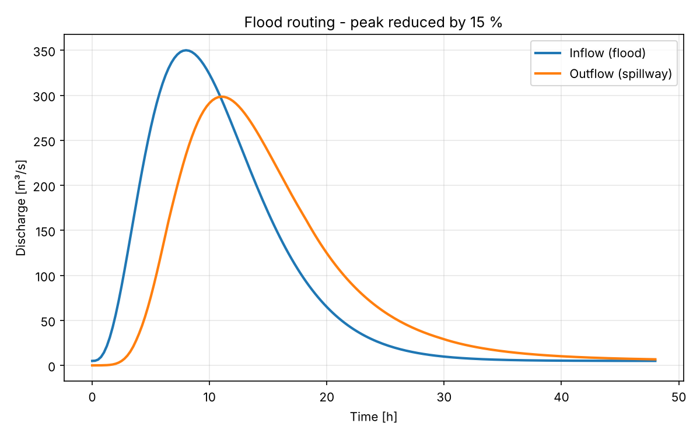
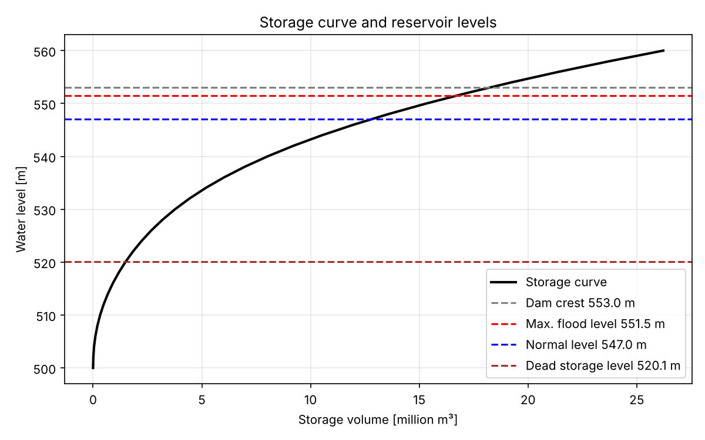

# Reservoir & Flood Routing – Simple Dam Design in Python

A small Python script for the basic hydraulic design of a drinking-water dam. It answers four questions:

1. **How much water can the valley hold?** (storage curve)
2. **How much space is needed for sediment and drinking water?** (storage zones)
3. **What happens during a big flood?** (flood routing over the spillway)
4. **How tall must the dam be?**

The idea comes from my reservoir and dam design project in the M.Sc. Civil Engineering programme at TUM.

> All input values are **example data for a fictional site**.

## Results





| Result | Value |
|---|---|
| Dead storage (sediment, 100 years) | 1.5 million m³ |
| Active storage (120,000 people + ecological flow) | 11.3 million m³ |
| Normal water level (spillway crest) | 547.0 m |
| Flood peak: inflow → outflow | 350 → 298 m³/s (−15 %) |
| Max. flood level | 551.5 m |
| Dam crest (with 1.5 m freeboard) | 553.0 m |
| Dam height | 53 m |

## Method

- **Storage curve:** volume = average area × height difference, summed up
- **Dead storage:** sediment per year × design life
- **Active storage:** yearly drinking water + ecological flow
- **Spillway:** Q = C · L · H^1.5
- **Flood routing:** water in − water out = change in storage (every 15 minutes)
- The reservoir is **full when the flood starts** (worst case, as in DIN 19700)

## How to run

```bash
pip install -r requirements.txt
python reservoir.py
```

To try other values, change the numbers in the **INPUT VALUES** section at the top of `reservoir.py` and run again.

## Files

| File | Content |
|---|---|
| `reservoir.py` | The full calculation |
| `elevation_area.csv` | Valley data: water level and lake area |
| `outputs/` | Charts and `results.csv` |

## Tools
Python · NumPy · pandas · Matplotlib

---
**Author:** Arya Aji, M.Sc. Civil Engineering, Technical University of Munich
